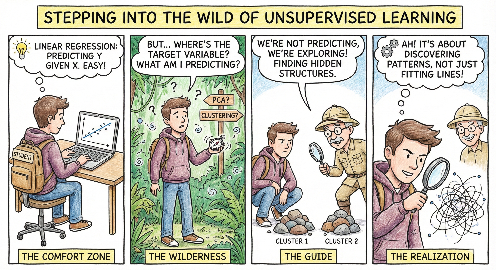
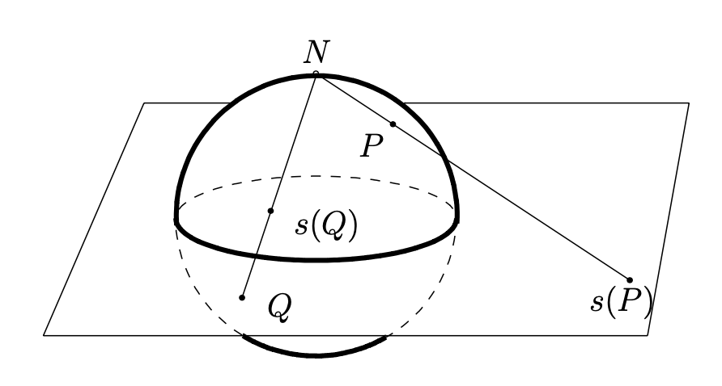
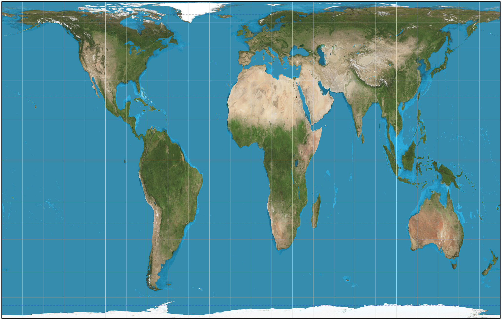
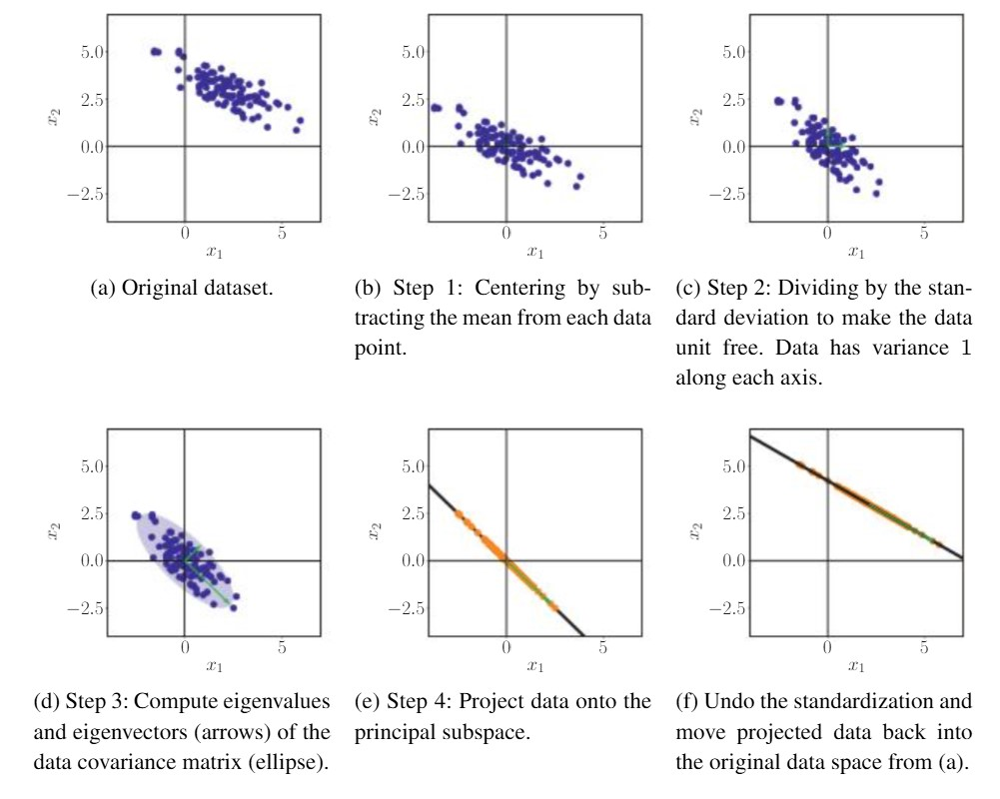
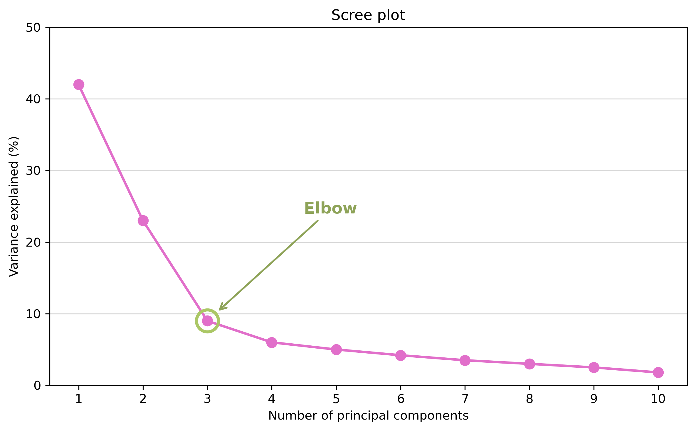
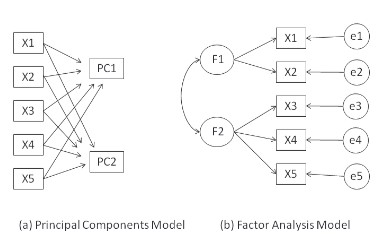
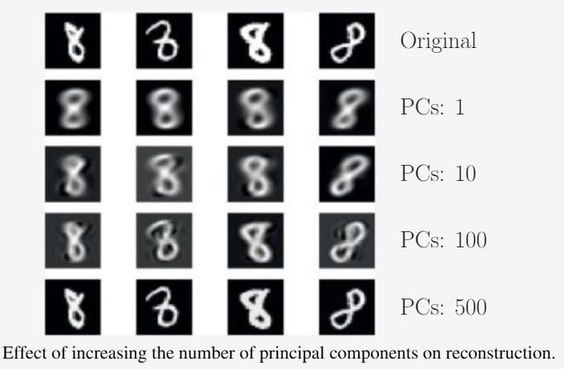
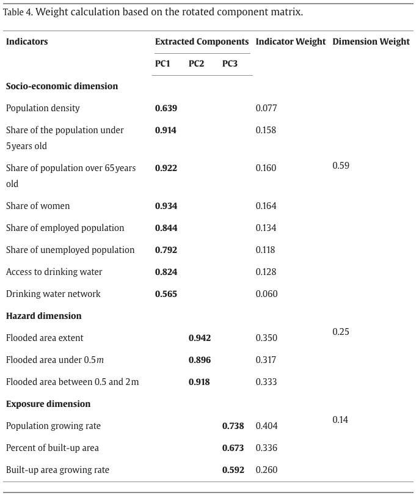

## Last week
**Lecture 8 was on multilevel regression**

Looked at:

::: {.incremental}
- Understand Ordinary Least Squares (OLS) and Linear Mixed Effects (LME) models 
- Understand the difference between *Fixed Effects* and *Random Effects*
- Can use Python or R to run OLS and LME
:::

## This week

<div style="text-align:center;">
  
  <div style="font-size:0.8em; color: #555; margin-top:4px;">
    Image credit: Google Gemini
  </div>
</div>

## Learning Objectives
By the end of this lecture you should be able to:

::: {.incremental}
1. Explain the motivation of dimensionality reduction
2. Describe the principle of Principal Component Analysis
3. Apply PCA to school datasets or other datasets
:::

# Supervised vs unsupervised learning
Two main categories of machine learning. 

## Supervised learning
[Machine learning techniques that use labelled datasets to train models to identify underlying patterns.]{style="color:#49a0c4"} 

::: {.incremental}
- There is a *target variable* (or label) to predict
- The *training dataset* has known target variable values
- Use the training dataset to build a model to predict the target variable for new data points
:::

## Unsupervised learning
[Machine learning techniques that identify patterns in unlabeled datasets.]{style="color:#49a0c4"} 

::: {.incremental}
- Theres is no target variable (label) to predict
- Want to discover hidden patterns or data groupings, without the need for human input
:::

. . .

Principal component analysis (PCA) and Clustering are both types of unsupervised learning. 

# High-dimensional data

## Dimensionality

[Dimensionality refers to the number of features or variables in a dataset.]{style="color:#49a0c4"} 

::: {.incremental}
- A tabular data of *M rows, N numerical columns* has a dimensionality of **N** (not *M*)
- Note: A column representing seasons in a year has a dimensionality of **4**, or **3** (if using one-hot encoding and K-1 dummy variables), rather than **1**
:::

## Quiz {.smaller}

:::: {.columns}

::: {.column width="50%"}

<div style="text-align:center;">
  
  <div style="font-size:0.8em; color: #555; margin-top:4px;">
    Image credit: www.photofacts.nl
  </div>
</div>

:::

::: {.column width="50%"}

Canon EOR R8 has a maximum resolution of 6000 * 4000 pixels for JPEG/HEIF, where every pixel corresponds to three colour channels (RGB). 

What is the dimensionality of an image from EOR R8?

- **A.** 6000 * 4000
- **B.** 6000 * 4000 * 3
- **C.** 1
- **D.** 6000 * 4000 * 3 * 2

:::

::::

:::{.notes}
In this case, the image has 6000 * 4000 pixels, and each pixel has 3 color channels (RGB). Therefore, the dimensionality is 6000 * 4000 * 3.
:::

## Quiz {.smaller}

:::: {.columns}

::: {.column width="50%"}

You are given the following dataset with 1000 rows and 3 columns. 

|   | x1   | x2   | month |
|---|------|------|-------|
| 0 | 1.2  | 4.5  | Jan   |
| 1 | 3.4  | 2.2  | Feb   |
| 2 | -0.5 | 3.3  | Mar   |
| 3 | 2.1  | -1.1 | Apr   |
| 4 | 0.0  | 0.7  | May   |
| ... | ...  | ...  | ...   |

:::

::: {.column width="50%"}

What is the dimensionality of the feature space for this dataset after one-hot encoding of the *month* column (with one category dropped)?

- **A.** 2
- **B.** 11  
- **C.** 13  
- **D.** 14  

:::

::::

## High-dimensional data 
*The curse of dimensionality!* 

When data has a large number of dimensions: 

::: {.incremental}
- Analysis is hard, e.g. multicollinearity & variable selection in linear models
- Interpretation is challenging
- Visualisation is impossible
- Storage is expensive
:::

## Exploitable properties 

::: {.incremental}
- Many dimensions are redundant and can be explained by a combination of other dimensions
- Many dimensions are correlated
- The data often lies in an underlying lower-dimensional space
:::

## Dimensionality reduction

::: {.incremental}
- We can reduce the dimensionality of data by generating a new set of (fewer) dimensions  
- Doesn't change the number of data points
- Often there is a cost of information loss
- It is *unsupervised learning*, and there is no ground truth to validate the result
- Can be viewed as *data compression*
:::

## Dimensionality reduction as compression

- *Music*: WAV → MP3 
  - typical size reduction ≈ 10:1
  - e.g. ∼50 MB → 5 MB for an album
- *Image*: TIFF → JPEG 
  - typical size reduction ≈ 5:1 to 10:1
- *Map projection*: Earth (3D ellipsoid) → 2D map 
  - dimension reduction 3:2, with distortion of area/shape/distance

::: {.notes}
TIFF - very high quality raster based image format. Standard output for high spec DSLRs. 
:::

## Map projection

::: {.r-stack}

<div class="fragment fade-out" data-fragment-index="1" style="text-align:center;">
  
  <div style="font-size:0.8em; color: #555; margin-top:4px;">
    Mathematical projection of a sphere onto a plane. The stereographic projection is conformal, meaning that it preserves angles. However, it does not preserve area or distance.
    Source: LibreTexts Mathematics.
  </div>
</div>

<div class="fragment fade-in" data-fragment-index="1" style="text-align:center;">
  
  <div style="font-size:0.8em; color: #555; margin-top:4px;">
    The Gall-Peters projection is an equal-area cylindrical map projection. It preserves area but distorts shapes, especially near the poles.
    Source: Wikipedia.
  </div>
</div>

:::

# Principal component analysis (PCA)

## PCA

- A method for linear dimensionality reduction
- Each new dimension is a linear combination of original ones
- Proposed by Pearson (1901)* and Hotelling (1933)
- Still one of the most popular techniques for data compression and visualisation

[*Pearson, Karl. "LIII. On lines and planes of closest fit to systems of points in space." The London, Edinburgh, and Dublin philosophical magazine and journal of science 2.11 (1901): 559-572]{style="font-size:0.6em; color:#555;"}

## Illustration

- simplified example of PCA from 2D to 1D
- Aim to find a 'direction' (i.e. a line) that keeps the most information (or variance) between data points in 2D

```{python}
import numpy as np
import pandas as pd
import matplotlib.pyplot as plt

# For reproducibility

rng = np.random.default_rng(0)

# ---- generate data ----

n = 80
x = rng.uniform(-5, 5, size=n) # x in [-5, 5]
noise = rng.normal(0, 0.15, size=n) # small Gaussian noise
y = 2 * x + 0.1 + noise # y = 2x + 0.1 + noise

df = pd.DataFrame({"x1": x, "x2": y})

# ---- make scatterplot ----

fig, ax = plt.subplots(figsize=(4, 4))

ax.scatter(df["x1"], df["x2"], s=25, color="navy")

# Axes through origin

ax.axhline(0, color="black", linewidth=1)
ax.axvline(0, color="black", linewidth=1)

ax.set_xlim(-12, 12)
ax.set_ylim(-12, 12)

ax.set_xlabel(r"x1")
ax.set_ylabel(r"x2")

ax.set_aspect("equal", adjustable="box")
plt.tight_layout()
plt.show()
```

## Which direction is the best?

:::: {.columns}

::: {.column width="50%"}
```{python}
import numpy as np
import matplotlib.pyplot as plt

# Reuse df from the previous cell
x = df["x1"].to_numpy()
y = df["x2"].to_numpy()

# ---- define projection directions ----
# x1 axis: direction (1, 0)
ux = np.array([1.0, 0.0])

# x2 axis: direction (0, 1)
uy = np.array([0.0, 1.0])

# line y = 2x + 0.1: direction (1, 2), normalized
u_line = np.array([1.0, 2.0])
u_line = u_line / np.linalg.norm(u_line)

# line y = x: direction (1, 1), normalized
u_diag = np.array([1.0, 1.0])
u_diag = u_diag / np.linalg.norm(u_diag)

# put points into a 2 x n matrix
P = np.vstack([x, y])

def project_onto_direction(P, u):
    """
    Orthogonal projection of points P (2 x n) onto 1D subspace spanned by u (2,).
    Returns projected points (2 x n).
    """
    # scalar coefficients for each point
    alpha = u @ P          # shape (n,)
    # projected points = u * alpha
    return np.outer(u, alpha)

P_x  = project_onto_direction(P, ux)
P_y  = project_onto_direction(P, uy)
P_l  = project_onto_direction(P, u_line)
P_d  = project_onto_direction(P, u_diag)

# ---- plotting ----
fig, ax = plt.subplots(figsize=(5, 5))

# original points
ax.scatter(x, y, s=25, color="black", label="Data")

# projection points
ax.scatter(P_x[0], P_x[1], s=20, color="tab:blue", label="Proj. on $x_1$ axis", alpha=0.2)
ax.scatter(P_y[0], P_y[1], s=20, color="tab:orange", label="Proj. on $x_2$ axis", alpha=0.2)
ax.scatter(P_l[0], P_l[1], s=20, color="tab:green", label=r"Proj. on $y=2x+0.1$", alpha=0.2)
ax.scatter(P_d[0], P_d[1], s=20, color="tab:red", label=r"Proj. on $y=x$", alpha=0.2)

# draw guide lines for the two non-axis directions
xx = np.linspace(-5, 5, 100)
ax.plot(xx, 2*xx + 0.1, color="tab:green", alpha=0.4)
ax.plot(xx, xx,         color="tab:red",   alpha=0.4)

# axes through origin
ax.axhline(0, color="black", linewidth=1)
ax.axvline(0, color="black", linewidth=1)

ax.set_xlim(-12, 12)
ax.set_ylim(-12, 12)

ax.set_xlabel(r"$x_1$")
ax.set_ylabel(r"$x_2$")

ax.set_aspect("equal", adjustable="box")
ax.legend(loc="upper left", fontsize=5)
plt.tight_layout()
plt.show()
```

:::

::: {.column width="50%"}

```{python}
#| results: asis

import numpy as np
import pandas as pd
from IPython.display import display, Markdown

# ---- define projection directions ----
ux = np.array([1.0, 0.0])   # x1 axis
uy = np.array([0.0, 1.0])   # x2 axis

u_line = np.array([1.0, 2.0])
u_line = u_line / np.linalg.norm(u_line)   # for y = 2x + 0.1

u_diag = np.array([1.0, 1.0])
u_diag = u_diag / np.linalg.norm(u_diag)   # for y = x

# data points in 2 x n matrix
P = np.vstack([x, y])

def project_onto_direction(P, u):
    # orthogonal projection of columns of P onto direction u
    alpha = u @ P           # (n,)
    return np.outer(u, alpha)  # 2 x n

# projections
P_x  = project_onto_direction(P, ux)
P_y  = project_onto_direction(P, uy)
P_l  = project_onto_direction(P, u_line)
P_d  = project_onto_direction(P, u_diag)

# ---- variance calculations ----
# variance of original data along both coordinates
var_x1 = np.var(x, ddof=1)
var_x2 = np.var(y, ddof=1)
total_variance = var_x1 + var_x2

def explained_variance(P_proj):
    # sum of variances of x and y components of the projected points
    var_proj = np.var(P_proj[0], ddof=1) + np.var(P_proj[1], ddof=1)
    proportion = var_proj / total_variance
    return var_proj, proportion

var_proj_x, prop_x = explained_variance(P_x)
var_proj_y, prop_y = explained_variance(P_y)
var_proj_line, prop_line = explained_variance(P_l)
var_proj_diag, prop_diag = explained_variance(P_d)

# ---- table ----
data = {
    "Direction": [
        "Original data (total)",
        "Projection on $x_1$ axis",
        "Projection on $x_2$ axis",
        "Projection on $y=2x+0.1$",
        "Projection on $y=x$",
    ],
    "Variance (explained)": [
        total_variance,
        var_proj_x,
        var_proj_y,
        var_proj_line,
        var_proj_diag,
    ],
    "Proportion of total": [
        1.0,
        prop_x,
        prop_y,
        prop_line,
        prop_diag,
    ],
}

df = pd.DataFrame(data)

md_table = df.to_markdown(index=False)

html = f"""
<div style="font-size: 15px;">
{md_table}
</div>
"""

display(Markdown(html))
```

:::

::::

## PCA automatically searching for informative directions {.smaller}

:::: {.columns}

::: {.column width="50%"}
- PCA automatically searches the most informative direction, called the **first principal component (PC)**
- After finding this one, PCA looks for a second PC:
  - Not overlapping the information already captured by the first PC
  - With as much spread as possible between data points
  - Not needed when 1st PC explains 100% variance
:::

::: {.column width="50%"}

```{python}
import numpy as np
import matplotlib.pyplot as plt
from sklearn.decomposition import PCA

# ------------------------------------------------------------------
# 1. Example 2D data (replace with your own x1, x2 if you have them)
# ---------------------------------------------------------------

X = np.column_stack([x, y])  # shape (n_samples, 2)

# ------------------------------------------------------------------
# 2. Fit PCA on the 2D data
# ------------------------------------------------------------------
pca = PCA(n_components=2)
pca.fit(X)

# Mean of data (center of PCA)
x_mean, y_mean = pca.mean_

# Principal directions (unit vectors)
# components_[0] = [v1x, v1y] for PC1, components_[1] for PC2
pc1 = pca.components_[0]
pc2 = pca.components_[1]

# Explained variance ratios
var1 = pca.explained_variance_ratio_[0]
var2 = pca.explained_variance_ratio_[1]

# ------------------------------------------------------------------
# 3. Build lines for PC1 and PC2 in (x, y) space
#    Each PC is a line through (x_mean, y_mean) with direction given
#    by the corresponding component.
# ------------------------------------------------------------------

# Choose how far to extend the lines (in units of the direction vector)
t = np.linspace(-3, 3, 100)

# PC1 line points
pc1_x = x_mean + t * pc1[0]
pc1_y = y_mean + t * pc1[1]

# PC2 line points
pc2_x = x_mean + t * pc2[0]
pc2_y = y_mean + t * pc2[1]

# Compute slopes and intercepts y = m x + b for labels
# Note: if pc[0] is extremely close to 0, the line is ~vertical.
eps = 1e-12

def line_params_from_point_and_dir(x0, y0, vx, vy):
    if abs(vx) < eps:
        # Treat as vertical: x = const; we will handle label separately
        return None, x0  # (slope=None, x_const)
    m = vy / vx
    b = y0 - m * x0
    return m, b

m1, b1 = line_params_from_point_and_dir(x_mean, y_mean, pc1[0], pc1[1])
m2, b2 = line_params_from_point_and_dir(x_mean, y_mean, pc2[0], pc2[1])

# ------------------------------------------------------------------
# 4. Plot scatter + PC lines
# ------------------------------------------------------------------
fig, ax = plt.subplots(figsize=(5, 5))

ax.set_xlim(-12, 12)
ax.set_ylim(-12, 12)

# Scatter of original points
ax.scatter(X[:, 0], X[:, 1], alpha=0.5, label="Data points")

# Plot PC1 and PC2 lines
ax.plot(pc1_x, pc1_y, color="red",  linewidth=2, label="PC1")
ax.plot(pc2_x, pc2_y, color="green", linewidth=2, label="PC2")

# Mark the mean
ax.scatter([x_mean], [y_mean], color="black", s=50, zorder=5, label="Mean")

# ------------------------------------------------------------------
# 5. Build line labels with equations and variance explained
# ------------------------------------------------------------------
def pc_label(name, m, b, var_ratio):
    if m is None:
        # Vertical line: x = const
        return f"{name}: x = {b:.3f},  var = {var_ratio*100:.1f}%"
    sign = "+" if b >= 0 else "-"
    return (f"{name}: y = {m:.3f} x {sign} {abs(b):.3f},  "
            f"var = {var_ratio*100:.1f}%")

label_pc1 = pc_label("PC1", m1, b1, var1)
label_pc2 = pc_label("PC2", m2, b2, var2)

# Place text labels near the end of each line
ax.text(pc1_x[-1], pc1_y[-1], label_pc1,
        color="red", fontsize=9, ha="left", va="bottom")
ax.text(pc2_x[-1], pc2_y[-1], label_pc2,
        color="green", fontsize=9, ha="left", va="bottom")

# Cosmetics
ax.set_xlabel("x1")
ax.set_ylabel("x2")
ax.set_title("PCA on (x1, x2): data and principal components")
ax.axhline(0, color="grey", linewidth=0.7)
ax.axvline(0, color="grey", linewidth=0.7)
ax.legend(loc="upper left")
ax.set_aspect("equal")  # so PCs are not visually distorted

plt.tight_layout()
plt.show()

```
:::

::::

## Generalisation to M-dimensional dataset

::: {.incremental}
- The example above is for illustration; [please don't apply PCA to a 2-D dataset in your work]{style="color:red"} 
- For data with M dimensions (not M columns), PCA method will find M (or fewer than M) PCs as a new space to represent the data points
- These PCs are ranked by variance explained, i.e. #1 PC with maximal variance, followed by #2, #3
- These PCs are uncorrelated with each other
- We will choose the first *k* PCs for analysis, usually $k$=2,3
:::

:::{.notes}
remember M dimensions is not the same as M columns. 
:::

## Different ways to understand PCA

1. Maximum variance perspective (we did it!)
2. Projection perspective
3. Maths perspective - Eigenvector Computation and Low-Rank Approximations*

- See *Chapter 10, Mathematics for Machine Learning*

## Maths perspective

- Mathematically PCA is built on Linear Algebra principles (week 4). 
- The goal is to describe the data using independent vectors. 
- This is acheived through cosntructing the covariance matrix, which captures the relationships between the different dimensions of the data.
- Read more in this Medium article: [The Math of Principal Component Analysis (PCA)](https://medium.com/analytics-vidhya/the-math-of-principal-component-analysis-pca-bf7da48247fc)

:::{.notes}
Very briefly thinking back to the linear algebra in week 4. 
:::

# PCA in practice

## Illustrating steps of PCA
<div style="text-align:center;">
  
  <div style="font-size:0.8em; color: #555; margin-top:4px;">
    Image credit: Mathematics for Machine Learning
  </div>
</div>

## How to choose k?

No hard and fast rule to choose the number of principal components, but there are some general guidelines.

:::{.incremental}
1. For visualisation: k = 2 or 3  
2. Keep components with eigenvalues > 1. *Eigenvalue* of a PC is proportional to variance explained by this PC
3. Scree plot (elbow method): use the point where the bend happens, where the curve changes from *steep* to *flat*
:::

## Scree plots

<div style="text-align:center;">
  
</div>

## Example: PCA on performance & disadvantage attributes of school data

```{python}
import pandas as pd
from IPython.display import display, Markdown

items = [
    ("PTFSM6CLA1A",
     "Percentage of pupils eligible for Free School Meals in the past six years (FSM6) and/or Children Looked After (CLA1A)."),
    ("PTNOTFSM6CLA1A",
     "Percentage of pupils not eligible for FSM6 and not CLA1A."),
    ("PNUMEAL",
     "Percentage of pupils whose first language is known or believed to be other than English."),
    ("PNUMFSMEVER",
     "Percentage of pupils who have ever been eligible for Free School Meals in the past six years (FSM6 measure)."),
    ("ATT8SCR_FSM6CLA1A",
     "Average Attainment 8 score for pupils eligible for FSM6 and/or CLA1A."),
    ("ATT8SCR_NFSM6CLA1A",
     "Average Attainment 8 score for pupils not eligible for FSM6 and not CLA1A."),
    ("ATT8SCR_BOYS",
     "Average Attainment 8 score for male pupils."),
    ("ATT8SCR_GIRLS",
     "Average Attainment 8 score for female pupils."),
    ("P8MEA_FSM6CLA1A",
     "Progress 8 measure for disadvantaged pupils (FSM6 and/or CLA1A)."),
    ("P8MEA_NFSM6CLA1A",
     "Progress 8 measure for non-disadvantaged pupils."),
]

# Create DataFrame
df_attributes = pd.DataFrame(items, columns=["Attribute", "Description"])

md_table = df_attributes.to_markdown(index=False)

html = f"""
<div style="font-size: 12px;">
{md_table}
</div>
"""

display(Markdown(html))


# display(Markdown(df_attributes.to_markdown(index=True)))
```

## Scree plot

:::: {.columns}

::: {.column width="50%"}

```{python}
# --- Imports ---
import numpy as np
import pandas as pd
import matplotlib.pyplot as plt

from sklearn.impute import KNNImputer
from sklearn.preprocessing import StandardScaler
from sklearn.decomposition import PCA

# --- Load data ---
df_school = pd.read_csv(
    "https://raw.githubusercontent.com/huanfachen/QM/refs/heads/main/"
    "sessions/L6_data/Performancetables_130242/2022-2023/england_filtered.csv"
)

# --- Select numeric columns for PCA ---
df_school_reduced = df_school[
    [
        'PTFSM6CLA1A', 'PTNOTFSM6CLA1A', 'PNUMEAL', 'PNUMFSMEVER',
        'ATT8SCR_FSM6CLA1A', 'ATT8SCR_NFSM6CLA1A',
        'ATT8SCR_BOYS', 'ATT8SCR_GIRLS',
        'P8MEA_FSM6CLA1A', 'P8MEA_NFSM6CLA1A'
    ]
]

# --- Imputation with KNNImputer ---
imputer = KNNImputer(n_neighbors=5)
df_school_reduced_imputed = imputer.fit_transform(df_school_reduced)

# Put back into a DataFrame with the same column names
df_school_reduced_imputed = pd.DataFrame(
    df_school_reduced_imputed,
    columns=df_school_reduced.columns
)

# --- Standardisation with StandardScaler ---
scaler = StandardScaler()
df_school_reduced_scaled = scaler.fit_transform(df_school_reduced_imputed)

df_school_reduced_scaled = pd.DataFrame(
    df_school_reduced_scaled,
    columns=df_school_reduced.columns
)

# --- PCA ---
pca = PCA()
pca_np_school_reduced = pca.fit_transform(df_school_reduced_scaled)

# Explained variance ratio
explained_var = pca.explained_variance_ratio_
num_components = len(explained_var)

# Table of explained variance and cumulative variance
df_explained_var = pd.DataFrame({
    "n_pc": np.arange(1, num_components + 1),
    "explained_var": explained_var,
    "cum_var": np.cumsum(explained_var)
})

# # print("Table of explained variance")
md_table = df_explained_var.round(3).to_markdown(index=False)

html = f"""
<div style="font-size: 18px;">
{md_table}
</div>
"""

display(Markdown(html))

# print(df_explained_var.to_markdown(index=False))
```


:::

::: {.column width="50%"}

```{python}
# --- Elbow detection using "turning point" (discrete second derivative) ---
y = explained_var
pcs = np.arange(1, num_components + 1)

if num_components < 3:
    k = 1
else:
    dy = np.diff(y)          # first differences
    ddy = np.diff(dy)        # second differences
    turning_idx = np.argmax(np.abs(ddy))
    k = turning_idx + 2      # convert to 1-based PC index

# print(f"Chosen k based on turning-point elbow detection: {k}")

# --- Visualise elbow on Scree plot ---
plt.figure(figsize=(6, 4))
plt.plot(pcs, explained_var, marker='o', label="Explained Variance Ratio")
plt.scatter(
    k, explained_var[k - 1],
    color='red', s=80, zorder=5,
    label=f"Turning-point elbow (k={k})"
)
plt.title("Scree Plot with Turning-Point Elbow")
plt.xlabel("Principal Component")
plt.ylabel("Explained Variance Ratio")
plt.xticks(pcs)
plt.grid(True, linestyle='--', alpha=0.5)
plt.legend()
plt.show()
```
:::

::::

## How many data points are sufficient for PCA

::: {.incremental}
- **Rule 1** "5-10 times as many subjects as variables"
  - e.g. with 10 variables, we need at least 50 or 100 data points
- **Rule 2**: with several hundred observations, PCA are probably reliable.
:::

. . .

- Reference: R in Action, by Robert I Kabacoff
- [Discussion on StackExchange](https://stats.stackexchange.com/questions/45820/minimum-sample-size-for-pca-or-fa-when-the-main-goal-is-to-estimate-only-few-com)


## *PCA* is not *factor analysis*

- PCA aims to find PCs that are combination of original variables for maximising the variance explained.
- Factor analysis (FA) aims to find hidden factors that underlie or *cause* the observed variables.

<div style="text-align:center;">
  
  <div style="font-size:0.8em; color: #555; margin-top:4px;">
    Source: R in Action
  </div>
</div>

## Balancing components with information loss

::: {.r-stack}

::: {.fragment .fade-out fragment-index=1 style="width:100%; margin:0; align-self:start;"}
Example of PCA on the [MNIST](https://www.kaggle.com/datasets/hojjatk/mnist-dataset) dataset. 

- 60,000 examples of handwritten digits 0~9.
- Each digit is an 28*28 image or 784 pixels (dimensions)
:::

<div class="fragment fade-in" data-fragment-index="1" style="text-align:center;">
  
  <div style="font-size:0.8em; color: #555; margin-top:4px;">
    Source: Chapter 10, Mathematics for Machine Learning
  </div>
</div>

:::

## Example of PCA on a research question 

::: {.r-stack}

::: {.fragment .fade-out fragment-index=1 style="width:100%; margin:0; align-self:start;"}
[Mapping social vulnerability to floods. A comprehensive framework using a vulnerability index approach and PCA analysis](https://www.sciencedirect.com/science/article/pii/S1470160X23009809)

- **Research question:** Create an index of social vulnerability to floods in the Somes-Tisa river basin in Romania.
- **Data:** 76 regions, each with data on 14 indicators 
  - indicators such as population density, population growth rate, percent of built up area, access to drinking water
  - note: 14 indicators = 14 dimensions
- **Method:** applied PCA to create a composite index of vulnerability.

:::

<div class="fragment fade-in" data-fragment-index="1" style="text-align:center;">
  
  <div style="font-size:0.8em; color: #555; margin-top:4px;">
    Source: Ajtai, I., Ștefănie, H., Maloș, C., Botezan, C., Radovici, A., Bizău-Cârstea, M., & Baciu, C. (2023). Mapping social vulnerability to floods. A comprehensive framework using a vulnerability index approach and PCA analysis. Ecological Indicators, 154, 110838.
  </div>
</div>

:::


## Using PCA is practise 

- large number of variables 
- want to reduce the variables 
- want to understand how the variables relate to each other

## Quiz 

::: {.incremental}
- What is the main goal of PCA?
- How should you decide how many principal components to retain?
- I have a dataset with a dimension of 3, should I use PCA to reduce it to 2 dimensions? Why or why not?
:::

## Key takeaways 

- High-dimensional data often lies in lower-dimensional space, thus dimensionality reduction is possible.
- PCA is a linear dimensionality reduction method.
- PCA aims to maximise variance explained by PCs.
- The output PCs are ranked by the explained variance, and these PCs are not correlated.
- PCA results can be used for visualisation or as input to regression/clustering.

## Practical 
- The practical will focus on calculating and interpreting PCA.  
- Have your questions prepared! 

